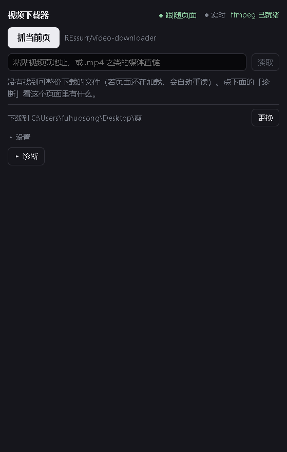

# 视频下载器（独立版）

> ## 前言
>
> 这是一个**软件工程专业大一新生**用 AI 全程跑出来的「大分视频下载器」，**仅作测试用**。
> 下面这份使用说明同样是 AI 写的——它尽量把话说清楚、把坑标出来，但仍然可能有错、有夸张、有遗漏，遇到问题以代码和自己的实测为准。

一个 Windows 桌面小工具：**把视频 / 音频文件的直链粘贴或拖进窗口就能下载**，支持断点续传；如果本机有 ffmpeg，还能把分离的视频轨与音频轨合成一个有声音的 mp4。

另外，装上配套的浏览器扩展后，它可以**自动跟随你在 Chrome / Edge 里正在看的页面**，把页面里的 `.mp4` 找出来——这个扩展是可选的，不装不影响下载链接。



它不是浏览器插件，而是一个**独立程序**（Electron 外壳 + 只监听本机的 HTTP 服务 + 一个可选装的浏览器扩展）。设计来源是作者之前写的 DSH 插件 `dsh-video-downloader`。

---

## 一、开箱即用（不需要装任何东西）

1. 在 [Releases](../../releases) 下载 `video-downloader-0.1.0-portable.exe`。
2. 双击运行（免安装；第一次启动要解压到临时目录，会慢几秒）。
3. 把媒体直链粘贴到输入框回车，或者拖进窗口，就开始下载。

关窗口不会退出程序，它会缩到右下角托盘；真正退出用托盘菜单里的「退出」。

> 这一步能下的是**直链文件**（`https://…/xxx.mp4` 这类）。页面里的播放器、登录态视频，见下面的可选扩展。

## 二、可选增强：跟随浏览器当前页面（需要装一次扩展）

GitHub 用户 / 开发者通常可以接受手动装扩展，普通用户看到"开发者模式"可能会退，所以这一步**不是必须的**。

> Chrome / Edge 没有让程序静默安装扩展的通道，所以只能手动做一次，之后一直有效。

1. 从 Releases 下载 `video-downloader-extension-0.1.0.zip` 并解压（如果你有源码，也可以直接用仓库里的 `extension/` 目录）。
2. 打开扩展管理页：
   - Edge：地址栏输入 `edge://extensions`
   - Chrome：地址栏输入 `chrome://extensions`
3. 打开「开发者模式」（Edge 在左下角，Chrome 在右上角）。
4. 点「加载已解压的扩展程序」，选择上一步解压出来的 `video-downloader-extension` 文件夹。
5. 回到本程序，面板上出现「浏览器扩展已连接」即成功；在浏览器里打开含视频的页面，点「抓当前页」。

注意：

- 本程序必须正在运行（窗口可以在托盘里），扩展才连得上；
- 装完扩展后要**刷新**之前已经打开的页面（content script 只注入新加载的页面）；
- 浏览器提示「请停用以开发者模式运行的扩展程序」时点「保留」，这是加载方式带来的提示，不是扩展坏了；
- 程序默认 `127.0.0.1:47821`，被占用会自动换到 47822–47830，扩展会自己重连。

## 三、ffmpeg（可选）

只保存整份 mp4 不需要 ffmpeg。要让「视频轨 + 音频轨」合成一个有声音的 mp4，本机需要 ffmpeg：

- 放到 `%APPDATA%\video-downloader\tools\bin\ffmpeg.exe`（目录不存在就自己建），或
- 把 `ffmpeg.exe` 所在目录加进 `PATH`。

面板会显示「ffmpeg 已就绪」或「没有找到 ffmpeg」。没有它时，需要合并的清晰度会被**隐藏并说明原因**，不会给你一个没声音的文件。

## 四、从源码构建

需要 Node.js 22+ 与 pnpm。

```powershell
pnpm install
pnpm dev        # 构建并启动
pnpm start      # 只启动（需先 pnpm build）
pnpm typecheck  # TypeScript 类型检查
pnpm test       # 全量测试（会先构建测试产物）
pnpm dist:win   # 出 Windows 便携单文件 exe，产物在 release/
```

"拿真东西验证"的两个脚本（可选）：

```powershell
pnpm test:e2e   # 真 Chrome + 真扩展 + 真落盘：截本地夹具页 → 扩展取字节 → 上传 → 逐字节比对（需本机装 Chrome）
pnpm verify:mux # 真 ffmpeg 合并：拆出视频轨/音频轨再合并，检查结果里同时有视频流和音频流
pnpm fixture    # 起本地验收夹具页 http://127.0.0.1:5399/page.html
```

> 跑 `test:e2e` 前请先从托盘退出正在运行的本程序：扩展会优先连到第一个应答的实例。

## 五、项目结构

| 路径 | 内容 |
| --- | --- |
| `src/host/` | 本机 HTTP/WS 服务、扩展通道、WebSocket 帧解码、旧配置继承 |
| `src/electron/` | Electron 外壳：窗口、托盘、扩展导出、启动日志 |
| `src/client/` | 渲染层（React 面板）：面板、设置、候选挑选、跟随逻辑 |
| `src/download.ts` | 下载引擎：并发队列、直连载体、扩展载体、断点续传 |
| `src/net/` | HTTP 抓取、代理识别、失败原因诊断 |
| `src/probe/` | 媒体策略（只提供 mp4 / 合并能力过滤 / 同清晰度折叠） |
| `extension-src/` | 浏览器扩展源码（MV3）：background、content script、站点适配器 |
| `extension/` | 构建出来的扩展产物（`pnpm build` 生成，浏览器加载的就是这个目录） |
| `web/` | 面板的 `index.html` |
| `test/` | 测试（Node 内置 test runner，直接打真实文件系统与本地 HTTP） |
| `docs/` | 架构说明、验收清单、Git 上手指南、发布说明 |

运行时数据都在本机，不在仓库里：配置 `%APPDATA%\video-downloader\config.json`，扩展导出位置 `%APPDATA%\video-downloader\extension`。

## 六、已知限制（都是实测出来的）

- **扩展需要手动装一次**：Chrome / Edge 不允许程序静默安装扩展，所以「跟随页面」对非技术用户有门槛；卸掉扩展后程序依然能下载直链。
- **只抓「文件」**：`<video src="….mp4">`、`<source>`、指向 mp4 的链接、页面里出现过的 mp4 请求地址。`blob:` / MSE（HLS、DASH 播放器常见形态）本身不是文件，抓不到；这类站点需要站点适配器，目前只有 B 站。
- **登录 / 防盗链**：扩展取字节时用的是浏览器自己的 cookie 和 IP，但它自己发请求、带不了页面的 `Referer`，个别站点会因此拒绝，此时会退回「本机直连」再试一次；两边都不行就是不行。
- **只支持 Windows**：打包方式和托盘行为都按 Windows 做。
- **同名不覆盖**：文件名按标题生成，已存在会加序号。
- 真实站点的抓取效果需要联网 + 登录自测；作者只在本地夹具页与 headless Chrome 上做过自动化验证。

## 七、常见问题

**双击 exe 没反应 / 闪一下就没了**

拿启动日志判断，别猜：

```powershell
$env:VD_START_LOG = "$env:TEMP\vd-boot.log"
.\release\video-downloader-0.1.0-portable.exe
Get-Content $env:VD_START_LOG
```

日志会写清卡在哪一步（单实例锁 / 服务监听 / 建窗口）。如果这台机器设过 `ELECTRON_RUN_AS_NODE`（装过 Electron 开发环境后偶有），它会让程序被强制当成 Node 跑并立即退出——`Remove-Item env:ELECTRON_RUN_AS_NODE` 后重试。

**扩展一直显示「未连接」**

1. 程序必须正在运行（窗口可以在托盘里）；
2. 扩展页里有没有红色错误，重新加载一次扩展；
3. 装完扩展后要**刷新**之前已经打开的页面。

**点「抓当前页」说没有可读取的标签页**

先在浏览器里切一下标签页（扩展靠标签页事件知道当前页），再点一次。

**下载失败**

展开那条任务的错误信息，或在「诊断」里看「本机直连 / 扩展 / 上传通道」三项。常见原因：站点要登录态（改用「扩展下载」）、防盗链（本机直连 403）、`.m3u8` 这类流式清单（本程序只保存整份文件）。

## 八、许可证与免责声明

MIT，见 [LICENSE](LICENSE)。

- 本项目**仅供学习、测试与技术研究使用**，请勿用于商业用途或侵犯他人权益；下载内容的使用请遵守来源网站的服务条款与当地法律。
- 软件按「现状」提供，不附带任何担保；因使用本软件造成的任何后果由使用者自行承担。
- 设计与部分文案、实现源自作者此前的 DSH 插件 `dsh-video-downloader`；独立版把「宿主」从插件环境搬进了独立进程，并把页面抓取从注入脚本改成了浏览器扩展。
